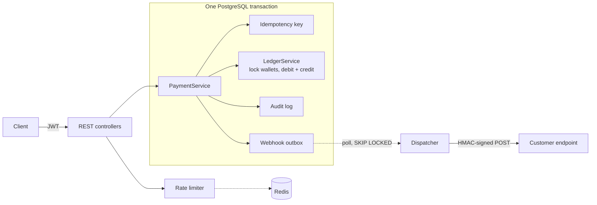

# Paycore

A payment backend that moves money correctly: wallets backed by a double-entry ledger, idempotent transfers that are
safe under concurrency, a transactional webhook outbox, and an append-only audit trail.

**Stack:** Java 21 · Spring Boot 3.5 · PostgreSQL 16 · Redis · Flyway · JWT · Testcontainers · Docker · GitHub Actions

---

## Quick start

```bash
docker compose up --build
```

- Swagger UI: http://localhost:8080/swagger-ui.html
- Health: http://localhost:8080/actuator/health

### Walkthrough

```bash
# 1. Register (returns a JWT)
TOKEN=$(curl -s localhost:8080/api/v1/auth/register -H 'Content-Type: application/json' \
  -d '{"email":"asha@example.com","password":"a-long-password","fullName":"Asha"}' | jq -r .accessToken)
AUTH="Authorization: Bearer $TOKEN"

# 2. Open an account and an INR wallet
ACCOUNT=$(curl -s localhost:8080/api/v1/accounts -H "$AUTH" -H 'Content-Type: application/json' \
  -d '{"name":"Main","type":"PERSONAL"}' | jq -r .id)
WALLET=$(curl -s localhost:8080/api/v1/accounts/$ACCOUNT/wallets -H "$AUTH" -H 'Content-Type: application/json' \
  -d '{"currency":"INR"}' | jq -r .id)

# 3. Deposit ₹500.00 (amounts are integers in minor units: 50000 paise)
curl -s localhost:8080/api/v1/wallets/$WALLET/deposits -H "$AUTH" -H 'Content-Type: application/json' \
  -H 'Idempotency-Key: deposit-001' -d '{"amount":50000}'

# Run the same command again: same response, header Idempotent-Replayed: true, no second deposit.

# 4. Statement with running balance
curl -s localhost:8080/api/v1/wallets/$WALLET/transactions -H "$AUTH"
```

## API

| Method | Path | Notes |
|---|---|---|
| POST | `/api/v1/auth/register`, `/api/v1/auth/login` | Returns a JWT (HS256, 1h) |
| POST / GET | `/api/v1/accounts`, `/api/v1/accounts/{id}` | Account = holder of funds (PERSONAL / BUSINESS) |
| POST / GET | `/api/v1/accounts/{id}/wallets` | One wallet per currency per account |
| GET | `/api/v1/wallets/{id}` | Current balance |
| GET | `/api/v1/wallets/{id}/transactions` | Paginated statement, newest first, with `balanceAfter` |
| POST | `/api/v1/wallets/{id}/freeze`, `/unfreeze` | Frozen wallets can't send or receive |
| POST | `/api/v1/wallets/{id}/deposits` | **Idempotency-Key required** |
| POST | `/api/v1/wallets/{id}/withdrawals` | **Idempotency-Key required** |
| POST | `/api/v1/transfers` | **Idempotency-Key required** |
| GET | `/api/v1/transactions/{id}` | Visible only to either party |
| POST / GET / DELETE | `/api/v1/webhooks` | Register endpoints; secret shown once |
| GET | `/api/v1/webhooks/{id}/deliveries` | Delivery log |
| POST | `/api/v1/webhooks/{id}/deliveries/{deliveryId}/retry` | Re-queue a dead delivery |
| GET | `/api/v1/audit-logs` | Everything the current user did |

All errors are [RFC 9457](https://www.rfc-editor.org/rfc/rfc9457) problem documents with a stable `code`
(`INSUFFICIENT_FUNDS`, `CURRENCY_MISMATCH`, `IDEMPOTENCY_KEY_REUSED`, ...). Resources owned by someone else return
`404`, not `403`, so IDs can't be probed.

---

## Design



### 1. Double-entry ledger

Every movement of money is a `ledger_transaction` with exactly two `ledger_entries`: a **DEBIT** on one wallet and a
**CREDIT** of the same amount on another. Money is never created or destroyed, only moved.

- **Deposits and withdrawals** go through a per-currency *settlement wallet* owned by a system account. It stands for
  money outside the platform and is the only kind of wallet allowed to go negative. So across all wallets of a
  currency, balances always **sum to zero**.
- `wallets.balance` is a cached projection of the entries, updated in the same transaction. Each entry stores
  `balance_after`, which makes the statement endpoint a single indexed query.
- Money is `BIGINT` minor units. No floats anywhere, and `Math.addExact` throws on overflow.

**The database enforces the invariants itself**, so a bug in the application can't corrupt the ledger:

| Invariant | Enforced by |
|---|---|
| Each transaction balances (credits = debits) | `DEFERRABLE INITIALLY DEFERRED` constraint trigger, checked at `COMMIT` |
| Ledger and audit log are append-only | `BEFORE UPDATE OR DELETE` triggers that raise |
| Customer wallets never go negative | `CHECK (allow_negative OR balance >= 0)` |
| Currency codes are valid | `CHECK (currency ~ '^[A-Z]{3}$')` + ISO 4217 validation in code |

`ReconciliationService` runs hourly. It recomputes every wallet's balance from its entries and checks the zero-sum
rule per currency, using one `REPEATABLE READ` snapshot so in-flight transfers can't cause false alarms.

### 2. Concurrency

A transfer locks both wallets with `SELECT ... FOR UPDATE`, then checks the balance and writes. Three details matter:

- **Deadlock avoidance:** locks are always taken in primary-key order (`ORDER BY id` in one locking query). A→B and
  B→A at the same time both lock the lower id first, so they queue instead of deadlocking.
- **No stale reads:** the wallet entity is never loaded before it is locked. Ownership and currency checks use scalar
  queries. Otherwise Hibernate would hand back an unlocked copy from the persistence context.
- **Second line of defence:** `@Version` optimistic locking on `Wallet`, so even a missed lock fails loudly with
  `409 CONCURRENT_MODIFICATION` instead of losing an update.

`ConcurrencyIT` fires 100 opposing transfers at once (no deadlocks, balances unchanged), and 40 parallel attempts to
spend 100 from a balance of 1,000 (exactly 10 succeed, balance ends at 0, never negative).

### 3. Idempotency

Clients send an `Idempotency-Key` header on every money-moving request. The key is claimed with
`INSERT ... ON CONFLICT DO NOTHING` **in the same transaction as the transfer**, and the response is stored in that
transaction too.

| Situation | Result |
|---|---|
| Retry after success | Stored response replayed, `Idempotent-Replayed: true` |
| Two identical requests at the same time | PostgreSQL blocks the second `INSERT` until the first commits, then it replays. Exactly one transfer (`IdempotencyIT` runs 20 at once) |
| Same key, different body | `422 IDEMPOTENCY_KEY_REUSED` (SHA-256 of operation + body) |
| First attempt failed (e.g. insufficient funds) | Whole transaction rolled back, key released, retry runs normally |

Keys are scoped per user and purged after 24 hours.

### 4. Webhooks: transactional outbox

Calling an HTTP endpoint inside a database transaction is a classic bug: the call can succeed while the transaction
rolls back, or the reverse. Instead, the transfer writes **outbox rows** (`webhook_deliveries`) in its own transaction,
so an event exists if and only if the money moved.

The dispatcher then:

- claims due rows with `FOR UPDATE SKIP LOCKED`, so any number of instances can run without double-sending;
- pushes `next_attempt_at` forward by a **lease** while a delivery is in flight, so a crashed instance's work is picked
  up again;
- signs each body: `Paycore-Signature: t=<unix>,v1=HMAC_SHA256(secret, "<t>.<body>")`. The timestamp lets receivers
  reject replays;
- retries with exponential backoff (10s, 20s, 40s, ... capped at 1h), then marks the delivery `DEAD` after 8 attempts.
  Dead deliveries can be re-queued through the API.

Delivery is at-least-once, and `event.id` is stable across retries so receivers can de-duplicate. Endpoint URLs must be
HTTPS and must not resolve to private, loopback or link-local addresses (basic SSRF protection).

### 5. Security and operations

- **JWT** via Spring Security's OAuth2 resource server (HS256, issuer validated). BCrypt passwords. Login takes the
  same time for unknown emails and wrong passwords, so it doesn't reveal which emails exist.
- **Rate limiting**: a fixed window in Redis (atomic `INCR` + `EXPIRE` in a Lua script), per user when authenticated
  and per IP otherwise. It **fails open**: if Redis is down, the payment API keeps working.
- **Audit log** of every sensitive action (logins including failures, wallet changes, money movement, webhook
  changes), with actor and IP, written in the same transaction as the change.
- Schema owned by **Flyway**. Hibernate only validates it (`ddl-auto: validate`).

---

## Testing

```bash
./mvnw verify          # unit + integration tests; integration tests need Docker (Testcontainers)
./mvnw test            # unit tests only
```

No Docker? Point the integration tests at any PostgreSQL 16 database:

```bash
TEST_DATABASE_URL=jdbc:postgresql://localhost:5432/paycore_test TEST_DATABASE_USERNAME=postgres ./mvnw verify
```

| Suite | What it proves |
|---|---|
| `ConcurrencyIT` | No deadlocks, no lost updates, no overdrafts under parallel load; reconciliation stays clean |
| `IdempotencyIT` | Replays, body mismatch, per-user scoping, failed-attempt retry, 20 concurrent same-key requests |
| `LedgerInvariantsIT` | The database itself rejects unbalanced transactions, ledger edits and negative balances |
| `PaymentFlowIT` | End-to-end money flows, statements, authorization, validation, audit trail |
| `WebhookIT` | Signed delivery to a real HTTP server, retry → `DEAD` → manual retry, nothing sent on rollback |
| `AuthIT` | Register/login, credential errors, token validation |
| Unit tests | Wallet arithmetic, HMAC signing, backoff, rate-limit filter, currency validation |

Every integration test goes through real HTTP against a real PostgreSQL. CI runs the whole suite plus a Docker build
on every push.

## Configuration

| Variable | Default | |
|---|---|---|
| `DATABASE_URL` / `DATABASE_USERNAME` / `DATABASE_PASSWORD` | `localhost:5432/paycore` | |
| `REDIS_HOST` / `REDIS_PORT` | `localhost:6379` | |
| `JWT_SECRET` | dev placeholder | **Set in every real environment** (≥ 32 bytes) |
| `RATE_LIMIT_ENABLED` | `true` | |
| `WEBHOOKS_ALLOW_PRIVATE_HOSTS` | `false` | Allow `http://` and private IPs (local dev only) |

Fine-grained settings (backoff, batch size, limits) live under `app.*` in `application.yml`.

## Known trade-offs and next steps

- **Hot settlement wallet:** every deposit in a currency locks the same settlement row, which caps deposit throughput.
  The fix is to shard it into N settlement wallets and pick one at random.
- **No FX:** transfers must be same-currency. Cross-currency would be two postings through FX wallets, at a quoted rate.
- **Synchronous rails:** deposits and withdrawals complete immediately. Real payouts would need a `PENDING` state, holds,
  and reversal entries (never edits).
- **SSRF at delivery time:** URLs are checked at registration. Checking again at delivery would also block DNS
  rebinding.
- **Single-tenant roles:** there's no admin role yet (for freezing any wallet, viewing global reconciliation, and so on).
